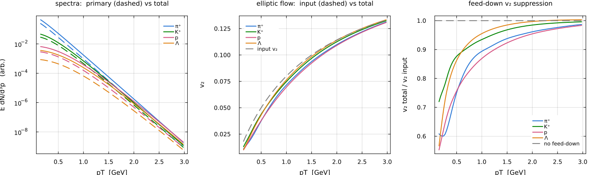
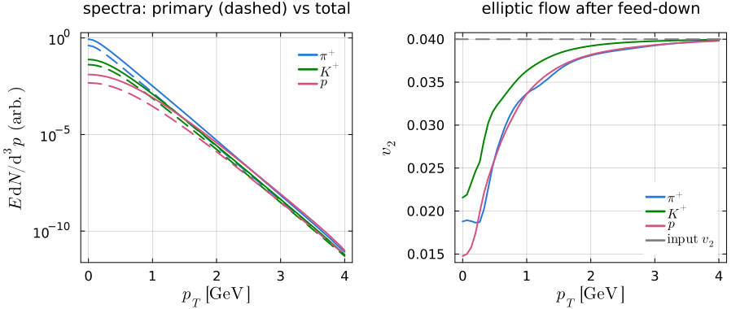
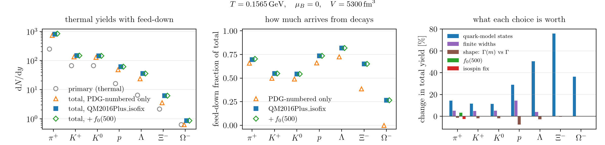

# FastReso2

Resonance **feed-down** for particle spectra in heavy-ion collisions: given a
thermal source of primary resonances, propagate every decay (2-, 3-, and
4-body) through the full feeder-before-fed cascade to obtain the final-state
spectra, including azimuthal (elliptic-flow) modulation. The decay map is a
**matrix** in transverse momentum and azimuthal Fourier mode, built once per
channel and reused across the cascade. The method is derived in
[`matrix_notes.tex`](matrix_notes.tex).



*The deliverable, from `figures/physics_feeddown.jl`: feed-down lifts the
spectra well above the primary (dashed) component, and dilutes v₂ relative to
the input — the suppression is strongest below 0.5 GeV and relaxes back toward
the input value over the next few GeV.*

**Implemented:** 2-/3-/4-body decays, boost-invariant (η-independent) sources,
Fourier modes `n = 0, 2`, the full cascade, channel filtering, finite parent
widths with channel reopening, and reusable compiled `CascadePlan` /
`ThermalPlan` execution. Broad parents use the threshold-vanishing
`MassDependentBW` by default; the constant-width `BreitWigner` remains
available.

**Still open:** rapidity-dependent (η-resolved) sources, cluster or observed-
daughter widths, broad-state tail control beyond `width_window`, and
state-dependent angular-momentum barrier factors.

## Requirements

**Julia ≥ 1.12** — the table build uses `Threads.@threads :greedy` (1.11) and
`OncePerTask` (1.12). Dependencies are in `Project.toml`; instantiate once, then
run everything with `--project`:

```bash
julia --project=. -e 'using Pkg; Pkg.instantiate()'
```

## Quick start

Checked in as `quickstart.jl`; run it with
`julia --project=. -t auto quickstart.jl`. It prints diagnostics and saves the
figure below to `figures/quickstart.png`.

```julia
using FastReso2

# 1. One decay, on its own
ρ = TwoBodyDecay(0.7752, 0.1396, 0.1396)          # ρ → π + π  (parent, observed, partner)
Fa(qT, η, ϕ) = exp(-hypot(0.7752, qT) * cosh(η) / 0.155)     # any parent spectrum
ρ(Fa, 0.5, 0.0, 0.0)                              # pion from ρ at pT = 0.5

grid = range(0.0, 4.0, length = 134)              # parent and daughter share the grid
W = decaymatrices(ρ, [0, 2], grid, grid)          # one matrix per mode; daughter = W * parent

# 2. The whole cascade
dl = DecayList(
    readparticles("data/particles_QM2016Plus_isofix.dat"),
    readdecays("data/decays_QM2016Plus_isofix.dat"),
)
T = 0.155
primary(p, n, qs) =                               # thermal source, 4% v₂ on mode 2
    (n == 0 ? 1.0 : 0.04) * p.degeneracy * [exp(-hypot(p.mass, q) / T) for q in qs]

qs  = range(0.0, 4.0, length = 61)
res = runcascade(dl; primary, grid = qs, spectral = :massdep, parallel = :modes)

# 3. Read it out
res.F[211][1]      # π⁺ spectrum after feed-down, mode n = 0
res.Fprim[211][1]  # the primary part alone
res.F[211][2]      # mode n = 2; v₂ is this divided by mode 0

# 4. Plot it
using Plots
plot(qs, res.F[211][1]; yscale = :log10, label = "π⁺ total")
plot!(qs, res.Fprim[211][1]; label = "π⁺ primary", ls = :dash)
```



*What the quickstart saves — the same feed-down effect as above, from twenty
lines and the default table. Feed-down roughly doubles the pion yield at
1 GeV (solid over dashed), and the K⁺ v₂ recovers toward the input faster than
π⁺ or p.*

`res.F[id]` and `res.Fprim[id]` are keyed by PDG id, one vector per Fourier mode
on `qs`. Results contain only stable particles by default; `stableparticles(dl)`
and `allparticles(dl)` list `ParticleInfo` records in ID order (both also accept
a `CascadePlan`). Pass `output = :all` only for diagnostics. The `primary`
callback is where the physics goes: return `zeros(length(qs))` to exclude a
species. Spectra are `Float64` by default; pass `spectrum_type = ComplexF64`
when the primary returns complex Fourier modes (e.g. ``F_n = |F_n| e^{-inΨ_n}``
with an event-plane phase) and the real decay kernels propagate both
components in one run.

For production, pass `cache = "Wtables.jls"` so the packed matrices are built
once and reloaded. The cache is regenerable and git-ignored (format 12);
incompatible older caches are rebuilt automatically.

## Usage

```bash
julia --project=. -e 'using Pkg; Pkg.test()'         # validate everything
julia --project=. -t auto figures/demo.jl              # minimal ρ→ππ / ω→πππ example
julia --project=. -t auto figures/demo_filter.jl       # feed-down by decay topology
julia --project=. -t auto figures/cascade.jl           # full cascade
julia --project=. -t auto figures/physics_feeddown.jl  # spectra + v₂(pT), π/K/p/Λ
julia --project=. -t auto figures/physics_charm.jl     # charm feed-down (needs the supplement)
julia --project=. -t auto figures/thermal_yields.jl    # thermal yields + feed-down, SHM style
julia --project=. -t auto figures/spectral_shape.jl    # Γ(m) vs constant Γ in pT spectra
CASCADE_BENCH_GRID=32 CASCADE_BENCH_SAMPLES=5 \
  julia --project=. -t 2 benchmarks/cascade_plan.jl   # plan-compilation benchmark
benchmarks/fastreso_crosscheck/run_small.sh        # cross-check against upstream FastReso
python3 -m unittest discover -s tests -p 'test_*.py' # offline generator/data invariants
```

`-t auto` matters for the table build, which parallelizes over channels and
fuses all Fourier modes into one quadrature sweep, and for
`runcascade(plan; parallel = :modes)`. Direct calls to a decay kernel are serial
by default; pass `threaded = true` only when qT-node parallelism is worthwhile.

The FastReso cross-check needs upstream built first — see
[`benchmarks/fastreso_crosscheck/README.md`](benchmarks/fastreso_crosscheck/README.md).
Figure scripts resolve paths from `@__DIR__` and write output next to
themselves.

## Input data

Particle metadata and decay topology are independent layers: `ParticleCatalog`
owns `ParticleInfo` records, names, aliases, and lookup; `DecayNetwork` owns
parent-to-channel rows and may refer to IDs from a catalog loaded later;
`DecayList` resolves the two into the strict, runnable model consumed by
filtering, tables, plans, and execution. See [`data/README.md`](data/README.md)
for provenance, legacy formats, and regeneration commands.

The runtime accepts one canonical split format and does not guess the source
convention:

```text
# particles
id name mass width degeneracy B S C Bot I Q [aliases...]

# decays
parent n_daughters branching_fraction daughters...
```

Aliases are optional whitespace-free labels; the daughter tail must contain
exactly `n_daughters` integer IDs. The former combined-file `DecayList(path)` /
`read_decaylist(path)` API has been removed. Supplements stay independent until
resolution, so one network can refer to daughters from another catalog:

```julia
catalog = merge(readparticles("data/particles_QM2016Plus_isofix.dat"),
                readparticles("data/particles_charm_bottom.dat"))
network = merge(readdecays("data/decays_QM2016Plus_isofix.dat"),
                readdecays("data/decays_charm_bottom.dat"))
dl = DecayList(catalog, network)
```

Format-specific parsing is an offline step under `tools/`, so new source formats
need no runtime API changes:

```bash
julia --project=. tools/convert_decay_data.jl azyhydro INPUT... \
  --particles-out particles.dat --decays-out decays.dat

julia --project=. tools/convert_decay_data.jl therminator \
  particles.data decays.data --cgc CGC.dat \
  --particles-out particles.dat --decays-out decays.dat
```

Resolution accepts only a sole `parent → parent` terminal row or runnable
2-/3-/4-body channels; unsupported multiplicities and unresolved references fail
before table construction. Branching fractions must be finite but are neither
clamped nor renormalized; `validate(dl)` reports values outside `[0, 1]` and
incomplete parent sums. `particle(catalog, id)` / `particle(catalog, name)`
retrieve a unique particle and `particleids(catalog, name)` returns every match
when a label is ambiguous; both accept a resolved list (`particle(dl, 211)`).
Catalog and network dictionaries are shared read-only — construct or merge a new
value rather than mutating after resolution.

`CascadeTable(...; grid=...)` requires an `AbstractRange{Float64}` and trusts
it, which keeps the grid compact and selects the uniform interpolation kernel
without validation scans. Standalone `DecayMatrix` objects still accept
non-uniform vectors.

## Channel filtering

A cascade run has three orthogonal knobs, which live in three different places:

| knob | question | where |
|------|----------|-------|
| **source** | which species emit primaries? | the `primary` callback (return `zeros(length(grid))` to exclude) |
| **topology** | which decays are allowed? | `filter(pred, dl)` before `CascadePlan` |
| **sink** | which daughters do I read out? | stable particles by default; `output = :all` for diagnostics |

Filtering acts on the `DecayList` before plan compilation, and numerical
execution consumes only the resulting plan. Filters are values of a composable
`ChannelFilter` type (combine with `&`, `|`, `!`):

```julia
t = CascadeTable(dl; cache = "Wtables.jls")              # full table, built once

hadronic = filter(nbody(2, 3) & !todaughter("Gamma"), dl)
selected = filter(parentmass(0, 0.7) | fromparent("omega(782)"), dl)

res = runcascade(CascadePlan(t, hadronic); primary)      # all plans reuse t
res = runcascade(t, selected; primary)                   # same, via a temporary plan

two_body = filter(nbody(2), dl)                          # or build only what you need
res = runcascade(CascadePlan(CascadeTable(two_body; cache = "W2.jls"), two_body); primary)

res = runcascade(selected; primary, grid = t.grid, cache = "Wselected.jls")  # one shot
res = runcascade(two_body; primary, width_cut = Inf)     # fast sharp-parent approximation
```

Ready-made filters (all return a `ChannelFilter`):

```
nbody(ns...)        parentmass(lo,hi)     daughtermass(lo,hi)   brabove(x)
fromparent(names…)  todaughter(names…)    fromid(ids…)          toid(ids…)
baryonicparent()    mesonicparent()       strangeparent()       charmparent()
parentstrangeness(ss…)  parentisospin(is…)  channelfilter(f)    # raw (p,ch,ds)->Bool
```

So you can **build once and filter freely** — each filtered plan reuses the full
table's matrices — **or build lean**, applying the same filter at construction so
only the matrices you will use are built. Give lean tables their own cache path,
since a filtered list keeps the parent list's hash. Name-based filters match
canonical `ParticleInfo.name` values; resolve an alias with
`fromid(particleids(dl, alias)...)` or `toid(particleids(dl, alias)...)`.

Parents wider than `width_cut` (GeV) use spectral averaging; the default is
`1.0e-3`, `Inf` disables width averaging, and `0.0` uses every positive width.
`width_window = 4.0` caps the integration range at `mass ± width_window * width`
(lower mass floored at `0.05 GeV`). `spectral = :massdep` is the default and
vanishes at the resolved species threshold; `spectral = :constant` selects the
constant-width Breit–Wigner. Thresholds are resolved before filtering, so
changing topology neither changes a primary thermal density nor prevents a
filtered plan from reusing a full table. Disabling four-body channels or widths
does not renormalize the retained branching fractions.

## Thermal yields

Statistical hadronization in the Andronic–Stachel sense: number densities at
chemical freeze-out, multiplied by a volume and fed down through the decay
network. No grid and no matrices — just one density integral per species and one
graph-ordered pass over the parents.



*From `figures/thermal_yields.jl`. Decays supply most of what is measured — 70%
of the pions, 82% of the Λ — so the yields are only as good as the branching
ratios behind them.*

```julia
y = thermalyields(dl, 0.1565; muB = 0.0, V = 5300.0)     # T [GeV], V [fm³]
y.primary[211], y.feeddown[211], y.total[211]            # π⁺ 249.5, 569.7, 819.2
```

Quantum statistics (`quantum`) and mass averaging (`width`) are independent
keywords, both on by default; `shape` picks the spectral function the average
runs over. `thermaldensity` and `primaryyields` are exported for the pieces.

For repeated evaluation — a fit scanning `(T, μ, V)` — compile a plan, which
hoists the momentum quadrature, a spectral rule per broad resonance, and the
flattened feed-down order:

```julia
plan = ThermalPlan(dl)                                 # ~10 ms, once
thermalyields(plan, 0.1565; muB = 0.0, V = 5300.0)     # ~1 ms, ~40× the list path
```

The plan agrees with the direct path to `3.6e-8`, not machine precision: it uses
a fixed 32-node rule where the direct path drives an adaptive integral at
`rtol = 1e-6`, which is where the agreement saturates.

**What each modelling choice is worth** — quark-model states, finite widths,
spectral shape, the σ, and the isospin fix, sized against each other with the
caveats that matter before comparing to data — is in
[`thermal_model_notes.md`](thermal_model_notes.md).

## Files

Runtime sources live in `src/`, canonical data in `data/`, figure scripts and
curated PNGs in `figures/`.

| File | Role |
|------|------|
| `src/FastReso2.jl` | Package entry point; loads the components and reexports the public API |
| `src/DecayModel.jl` | Resolved `DecayList`, filtering, validation, thresholds, graph feed-down order |
| `src/DecaySpectra.jl` | Core decay map: 2-/3-/4-body kernels and multi-mode matrix assembly |
| `src/CascadeTables.jl` | Persistent packed matrices, feeder-first cascade, compiled flat plans |
| `src/RowBandMatrix.jl`, `src/CascadeLinearAlgebra.jl` | Row-band storage and its `mul!` / scatter kernels |
| `src/LagrangeWeights.jl` | Lagrange weights — value, 1st/2nd derivative (uniform + non-uniform grids) |
| `src/ParticleList.jl`, `src/readers/Canonical.jl` | Catalog/network types and the split-file reader |
| `src/ThermalModel.jl` | Freeze-out densities, feed-down yields, `ThermalPlan` |
| `quickstart.jl` | The Quick start above, as a runnable script → `figures/quickstart.png` |
| `test/runtests.jl`, `runtests.jl` | `Pkg.test()` entry point, delegating to the legacy numerical suite |
| `benchmarks/`, `figures/`, `tools/` | Benchmarks and cross-checks, figure drivers, offline converters/generators |
| `matrix_notes.tex` | Method notes (compiled: `matrix_notes.pdf`) |
| `*_plan.md`, `pdg_audit.md`, `thermal_model_notes.md` | Design notes, data audit, thermal modelling results |

## License

The code is released under the [MIT License](LICENSE). The bundled physics
**data** is not covered by it and carries its own provenance:

- `data/azyhydro/decays_QM2016Plus_massorder.dat` — a thermal-model decay list
  produced elsewhere; cite and reuse it under the terms of its original source.
- `data/azyhydro/decays_charm_bottom.dat` — generated by
  `tools/gen_heavy_flavour.py` from the [Particle Data Group](https://pdg.lbl.gov)
  database, licensed under [CC BY 4.0](https://creativecommons.org/licenses/by/4.0/);
  cite the PDG *Review of Particle Physics* if you use it. The generated header
  records the database release, schema version, license, and citation.

Files under `data/` are deterministic canonical conversions of these sources,
retain the source path and SHA-256 in their headers, and carry the same
provenance and licensing.

### Regenerating the charm/bottom supplement

The generator is pinned to the PDG edition used by the checked-in artifact:

```bash
python3 -m pip install -r tools/requirements-heavy-flavour.txt
python3 tools/gen_heavy_flavour.py --check
python3 tools/gen_heavy_flavour.py --force  # regenerate after reviewing drift
julia --project=. tools/convert_decay_data.jl azyhydro \
  data/azyhydro/decays_charm_bottom.dat \
  --particles-out data/particles_charm_bottom.dat \
  --decays-out data/decays_charm_bottom.dat --force
```

Generation is validated in memory and replacement is atomic. Missing required
properties abort generation, except for the documented neutral `Σ_b` mass and
width estimates taken from their charged isospin partners. PDG upper limits and
modes without numerical branching fractions are never converted into
probabilities, and tables of only relative ratios are omitted. Retained absolute
branching fractions are not renormalized by default, so unsupported probability
produces no modeled feed-down; `--branching-policy conditional` is the explicit
normalized alternative. Under the default policy, `validate` reports parents
with `ΣBR < 1` as normalization outliers, quantifying incomplete modeled
coverage rather than an invalid branching fraction.
