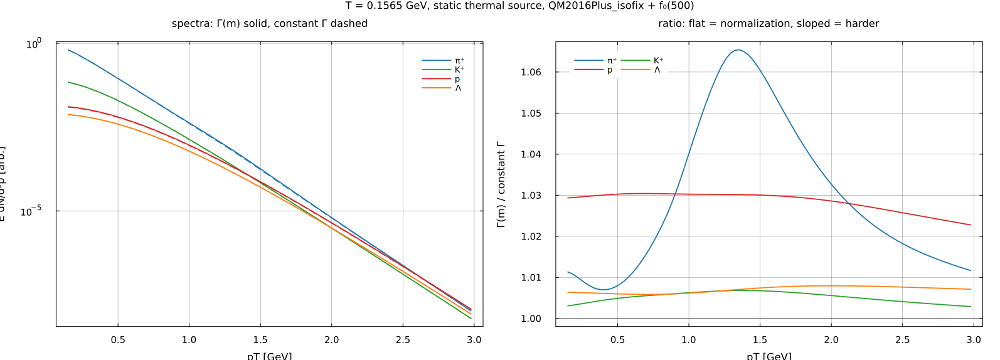

# What each modelling choice is worth

Sizing the thermal-yield modelling choices against each other, at
`T = 156.5 MeV, μ_B = 0, V = 5300 fm³`. Each row is measured against the row
above it. `figures/thermal_yields.jl` prints all of it and plots the last four.
See the [README](README.md) for the `thermalyields` API these rows exercise.

| | π⁺ | K⁺ | p | Λ | Ξ⁻ | Ω⁻ |
|---|---:|---:|---:|---:|---:|---:|
| quark-model states over PDG-numbered | +14.5% | +11.6% | +29.1% | +50.5% | +75.9% | +36.4% |
| finite widths over pole mass | +5.1% | +4.9% | +14.4% | +4.1% | +0.1% | +0.1% |
| shape: `Γ(m)` vs constant `Γ` | −1.4% | −1.8% | −7.5% | −2.7% | −0.3% | −0.02% |
| `f0(500)` | +3.3% | 0 | 0 | 0 | 0 | 0 |
| isospin fix (`isofix`) | −2.6% | 0 | 0 | 0 | 0 | 0 |

Finite widths are the largest correction and the least uniform, because a mass
average rewards the low-mass side where the Boltzmann factor is cheaper: +14%
for the proton, fed by the broad Δ(1232) and the N\* tower, against +0.1% for
the Ω⁻, whose few feeders are all narrow. That alone moves `p/π` from 0.0678 to
0.0738, so switching widths off is a different model rather than a small
perturbation.

## Which spectral function carries the width

That is a separate physics choice, and `shape` selects it. `:massdep` (default)
gives each resonance a threshold-vanishing width `Γ(m) ∝ (mR/m)·q(m)/q(mR)`, so
it carries no weight below the mass of its own decay products; `:constant`
freezes `Γ(m) = Γ`. At ℓ = 0 the two do not order universally — truncation
removes low-mass weight while the tail adds high-mass weight, and which wins
depends on where the threshold sits inside the window. Density relative to the
pole mass:

| | ρ | σ | Δ(1232) | K\* |
|---|---:|---:|---:|---:|
| `:massdep` | 1.044 | **0.551** | 0.902 | 1.004 |
| `:constant` | 1.043 | **0.457** | 0.952 | 1.017 |

*From `figures/spectral_shape.jl`. The choice is worth a few percent in the
spectra, and it is not a flat normalization — the pion ratio peaks near
1.35 GeV, while the proton's stays flat to 1.5 GeV before sloping down.*

The σ is where the two shapes part, and it is the state the threshold treatment
exists for: a constant-width shape puts 2.56% of its weight below `2m_π`, which
is mass the state cannot have. Both shapes are available in the cascade as the
`spectral` table option, consuming the same package-level spectral-shape types.

`isofix` and the σ are the same kind of change from opposite directions. The
three entries `isofix` patches (η, a₁(1260), K(1630)) feed pions and nothing
else, which is why both rows are zero to the digit everywhere but π⁺.

## Two caveats before comparing with data

Feed-down supplies **70%** of the pions on this list (71% with the σ), so the
answer is dominated by branching ratios that are curated rather than measured —
1167 of the 1518 light species are quark-model states, and `pdg_audit.md`
records that only η and ω regenerate from PDG.

And more states means more feed-down, so this list sits above the published SHM
ratios; the PDG-numbered layer is reported alongside to size that effect.
Agreement at the 10% level is the realistic target.
